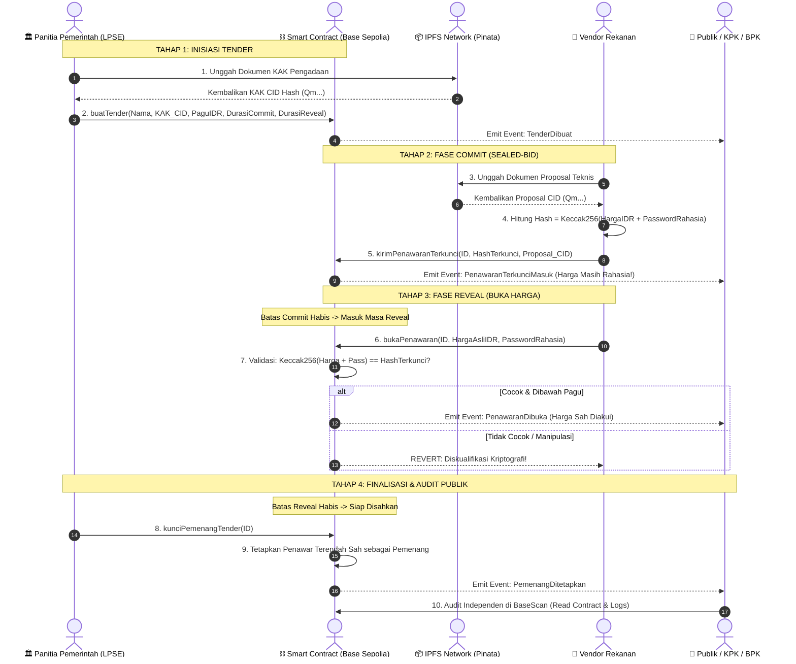

# 🏛️ TranspaTender ID — Decentralized E-Procurement System

[](https://soliditylang.org/)
[](https://sepolia.basescan.org/)
[](https://sepolia.basescan.org/address/0xEada85d712CBfb00BB3fE939D6A4fF758772e380#code)
[](https://pinata.cloud/)
[](LICENSE)

> **TranspaTender ID** adalah sistem pengadaan barang dan jasa (*e-procurement*) pemerintah berbasis *blockchain* L2 (**Base Sepolia Testnet**) yang memadukan protokol kriptografi **Commit-Reveal (Sealed-Bid)** dan penyimpanan terdesentralisasi **IPFS**. Sistem ini dirancang untuk membasmi praktik korupsi, kolusi, dan nepotisme (KKN) seperti pembocoran harga lelang oleh orang dalam (*insider trading*), manipulasi batas waktu (*backdating*), serta pengubahan pemenang tender di balik pintu.

---

## 📑 Daftar Isi
1. [Fitur Utama & Keunggulan](#-fitur-utama--keunggulan)
2. [Alamat Smart Contract Terverifikasi](#-alamat-smart-contract-terverifikasi)
3. [Panduan Lengkap Audit Publik via BaseScan (Langkah Demi Langkah)](#-panduan-lengkap-audit-publik-via-basescan-langkah-demi-langkah)
4. [Mengapa Harga Terlihat di Fase Reveal? (Zero Insider Trading)](#-mengapa-harga-terlihat-di-fase-reveal-zero-insider-trading)
5. [Arsitektur & Alur Kerja Sistem (Workflow)](#-arsitektur--alur-kerja-sistem-workflow)
6. [Struktur Direktori Proyek](#-struktur-direktori-proyek)
7. [Panduan Instalasi & Menjalankan Aplikasi](#-panduan-instalasi--menjalankan-aplikasi)
8. [Panduan Menghubungkan Jaringan Base Sepolia](#-panduan-menghubungkan-jaringan-base-sepolia)
9. [Kepatuhan Regulasi & Mata Uang Rupiah (IDR)](#-kepatuhan-regulasi--mata-uang-rupiah-idr)
10. [Lisensi](#-lisensi)

---

## ✨ Fitur Utama & Keunggulan

* 🔒 **Protokol Lelang Tertutup (Commit-Reveal Sealed-Bid):** Harga penawaran vendor dienkripsi satu arah menggunakan algoritma `Keccak-256`. Bahkan Panitia Presiden, Menteri, atau Administrator Database **tidak dapat melihat harga penawaran** sebelum masa pendaftaran ditutup permanen.
* 🛡️ **Zero Insider Trading & Anti-Sniping:** Mustahil ada vendor titipan yang mengajukan harga lebih murah Rp 1 di detik-detik terakhir karena semua komitmen harga telah terkunci mati di fase awal.
* 📦 **Penyimpanan Terdesentralisasi IPFS (Pinata):** Dokumen Kerangka Acuan Kerja (KAK) pemerintah dan Proposal Teknis vendor di-*pin* ke jaringan IPFS permanen. Dokumen tidak bisa disunting, dihapus, atau ditukar secara sepihak.
* 🏛️ **Dual Portal Presentation:** Antarmuka dipisahkan menjadi dua modul mandiri:
  * **Portal Pemerintah (LPSE / PPK):** Untuk menerbitkan paket tender, menetapkan pagu IDR, memantau lelang, dan mengesahkan pemenang.
  * **Portal Rekanan Vendor:** Untuk melihat katalog lelang, kalkulator *hash*, mengajukan penawaran terkunci, brankas sandi lokal, dan uji coba anti-curang.
* 🔍 **Pusat Audit Publik & Laporan KPK/BPK (Audit Explorer):** Tersedia modul audit independen dengan verifikator kriptografi untuk membuktikan integritas matematis setiap transaksi langsung di peramban.

---

## 📜 Alamat Smart Contract Terverifikasi

Smart contract TranspaTender telah resmi dideploy dan diverifikasi (*Source Code Published & Verified*) dengan centang hijau di Block Explorer **Base Sepolia**:

| Parameter | Nilai Resmi |
| :--- | :--- |
| **Network** | Base Sepolia Testnet (Ethereum Layer-2) |
| **Chain ID** | `84532` (Hex: `0x14a34`) |
| **Contract Address (v2 - Nama PT On-Chain)** | [`0x632d1F94F2D0f35128904bf062a568d2189586bb`](https://sepolia.basescan.org/address/0x632d1F94F2D0f35128904bf062a568d2189586bb) |
| **Contract Address (v1 - Base Protocol)** | [`0xEada85d712CBfb00BB3fE939D6A4fF758772e380`](https://sepolia.basescan.org/address/0xEada85d712CBfb00BB3fE939D6A4fF758772e380#code) |
| **Compiler Version** | `Solidity v0.8.20+commit.a1b79de6` |
| **Optimization** | Yes (200 Runs) |
| **License** | MIT License |
| **Explorer Link** | [Buka Kontrak v2 di Basescan ↗](https://sepolia.basescan.org/address/0x632d1F94F2D0f35128904bf062a568d2189586bb) |

---

## 🔍 Panduan Lengkap Audit Publik via BaseScan (Langkah Demi Langkah)

Siapapun (masyarakat, jurnalis, mahasiswa, auditor BPK, maupun penyidik KPK) dapat mengaudit jalannya pengadaan secara independen langsung melalui BaseScan tanpa perlu mendaftar atau meminta izin kepada panitia.

### 1. Memeriksa Pemenang Sah & Nilai Kontrak Akhir
1. Buka tautan: [BaseScan Contract Events ↗](https://sepolia.basescan.org/address/0xEada85d712CBfb00BB3fE939D6A4fF758772e380#events)
2. Cari baris event dengan nama **`PemenangDitetapkan`**.
3. Klik ikon dropdown `>` untuk melihat detail log:
   * **`idTender`**: Nomor ID paket tender yang dimenangkan.
   * **`pemenang`**: Alamat dompet Web3 resmi vendor pemenang lelang (contoh: `0xd04a8d3E5cbA17B1a7AE53704F16C531614C8322`).
   * **`hargaFinalIDR`**: Nilai kontrak final yang sah dalam satuan Rupiah (contoh: `900000000` = Rp 900.000.000).

---

### 2. Memeriksa & Mengunduh Dokumen Proposal Teknis Milik Vendor
1. Buka tab **[Contract]** $\rightarrow$ sub-tab **[Read Contract]**:  
   👉 [https://sepolia.basescan.org/address/0xEada85d712CBfb00BB3fE939D6A4fF758772e380#readContract](https://sepolia.basescan.org/address/0xEada85d712CBfb00BB3fE939D6A4fF758772e380#readContract)
2. Cari fungsi nomor **4. `dataPenawaran`**:
   * Masukkan `_idTender`: Angka ID Tender (contoh: `8`).
   * Masukkan `_vendor`: Alamat wallet vendor (contoh: `0xd04a8d3E5cbA17B1a7AE53704F16C531614C8322`).
   * Klik tombol **Query**.
3. Smart Contract akan menampilkan parameter:
   * **`hashTerkunci`**: Bukti komitmen harga asli yang dicatat saat Fase Commit.
   * **`ipfsProposalTeknis`**: Tautan atau CID IPFS dokumen proposal teknis vendor.
   * **`hargaTerbukaIDR`**: Nominal harga asli yang diungkap saat fase Reveal.
   * **`sudahReveal`**: `true` (menandakan proposal sah dibuka).
   * **`memenuhiSyaratPagu`**: `true` (menandakan penawaran berada di bawah pagu lelang).
4. **Cara Membuka File Proposal di Browser:**  
   Salin teks pada `ipfsProposalTeknis` (contoh: `QmX9iradQL8AicyJr5DkeEm2FQkaPMzELe4nfSpeJdkpZ7`) dan buka melalui IPFS Gateway:  
   `https://gateway.pinata.cloud/ipfs/QmX9iradQL8AicyJr5DkeEm2FQkaPMzELe4nfSpeJdkpZ7`  
   *(Dokumen PDF resmi proposal vendor lengkap dengan susunan tim dan rincian teknis akan langsung terbuka).*

---

### 3. Memeriksa Dokumen Kerangka Acuan Kerja (KAK) Pemerintah
1. Di tab **[Read Contract]** yang sama, cari fungsi nomor **3. `daftarTender`**:
   * Masukkan `_idTender`: Angka ID Tender (contoh: `8`).
   * Klik **Query**.
2. Anda akan mendapatkan data paket tender:
   * `namaProyek`: Nama proyek pengadaan (contoh: `"Pengadaan Bangunan Rektorat"`).
   * `ipfsDokumenKAK`: CID dokumen KAK resmi yang diunggah PPK ke IPFS.
   * `paguAnggaranIDR`: Batas maksimal anggaran negara (contoh: `10000000000` = Rp 10 Miliar).
   * `batasWaktuCommit` & `batasWaktuReveal`: Waktu blok penutupan lelang.
   * `selesai`: `true` jika lelang sudah disahkan.
   * `pemenang`: Alamat vendor pemenang.
   * `penawaranTerendahIDR`: Nilai penawaran terendah yang menang.

---

## 🔒 Mengapa Harga Terlihat di Fase Reveal? (Zero Insider Trading)

Sering timbul pertanyaan: *"Jika saat Fase Reveal harga lelang mulai terbaca oleh Panitia dan publik, apakah Panitia bisa berbuat curang?"*

**Jawabannya: MUSTAHIL BISA DICURANGI.**

Mekanisme keamanan matematis menjamin:
1. **Fase Commit Sudah Ditutup Permanen:** Saat masuk Fase Reveal, waktu pendaftaran lelang sudah habis. Smart Contract menolak pendaftaran vendor baru. Tidak ada celah bagi "vendor siluman/titipan" untuk masuk.
2. **Kompetitor Tidak Bisa Mengubah Harga:** Meskipun kompetitor melihat vendor lain menawar Rp 900.000.000, kompetitor **TIDAK BISA** mengubah penawarannya menjadi Rp 899.000.000. Komitmen *hash* mereka sudah terkunci sejak fase awal. Jika mencoba memasukkan angka yang berbeda 1 Rupiah saja, Smart Contract otomatis mendiskualifikasi vendor tersebut!
3. **Analogi Sidang Pleno Terbuka:**  
   * **Fase Commit:** Amplop disimpan di brankas baja tertutup (harga rahasia 100%).
   * **Fase Reveal:** Acara pembukaan amplop lelang bersama di hadapan seluruh saksi dan publik. Membuka harga di fase ini adalah syarat mutlak transparansi agar publik dapat mengawasi penawar terendah yang berhak menang.

---

## 🔄 Arsitektur & Alur Kerja Sistem (Workflow)



---

## 📁 Struktur Direktori Proyek

```text
transpatender-id/
├── contracts/
│   └── TranspaTender.sol         # Source code Smart Contract Solidity (v0.8.20)
├── src/
│   ├── components/
│   │   ├── AuditExplorer.jsx     # Modul Audit Publik & Verifikator Keccak-256
│   │   ├── CreateTenderModal.jsx # Modal Penerbitan Tender Baru oleh PPK
│   │   ├── GovernmentPortal.jsx  # Antarmuka LPSE Panitia Pemerintah
│   │   ├── Header.jsx            # Bilah Navigasi Utama & Switcher Mode
│   │   ├── IpfsConfigModal.jsx   # Pengaturan Gateway & Pinata JWT
│   │   ├── IpfsUploadField.jsx   # Komponen Drag-and-Drop Pinning IPFS
│   │   ├── PortalSwitcherBar.jsx # Bilah Cepat Pindah Portal (Gov <-> Vendor)
│   │   ├── TenderDetailModal.jsx # Rincian Audit, Dokumen KAK & Proposal
│   │   ├── TenderList.jsx        # Daftar Kartu Paket Tender & Timeline
│   │   ├── VendorPortal.jsx      # Antarmuka Rekanan (Commit, Reveal, Vault)
│   │   └── Web3ControlBar.jsx    # Status Koneksi Wallet, Switch Network & Faucet
│   ├── context/
│   │   └── TenderContext.jsx     # State Manager Web3 & Logika Sinkronisasi On-Chain
│   ├── contracts/
│   │   ├── contractAbi.js        # ABI & Konfigurasi Jaringan Base Sepolia
│   │   └── TranspaTenderBuild.json # Metadata Bytecode & ABI Kompilasi
│   ├── utils/
│   │   ├── crypto.js             # Generator Hash Keccak-256 & Formatter Rupiah
│   │   └── ipfsService.js        # Integrasi Pinata Cloud API & Gateway Resolver
│   ├── App.jsx                   # Root Component & Routing Portal
│   ├── index.css                 # Desain Tema Clean Governance (Tailwind CSS)
│   └── main.jsx                  # Entry Point React
├── compile.js                    # Script Node.js Kompilasi Solc Internal
├── original_contract.sol         # Salinan Master Bytecode-Matched Contract
├── package.json                  # Dependensi Proyek (Vite, React, Ethers.js v6)
├── tailwind.config.js            # Konfigurasi Tema UI
├── vite.config.js                # Konfigurasi Bundler Vite
└── README.md                     # Dokumentasi Resmi Proyek
```

---

## 🚀 Panduan Instalasi & Menjalankan Aplikasi

### 1. Prasyarat Sistem
* [Node.js](https://nodejs.org/) v18.0.0 atau yang lebih baru.
* Ekstensi browser [MetaMask](https://metamask.io/).

### 2. Kloning Repositori & Instalasi Dependensi
```bash
# Kloning repositori
git clone https://github.com/username/transpatender-id.git

# Masuk ke direktori proyek
cd transpatender-id

# Pasang seluruh dependensi
npm install
```

### 3. Konfigurasi Lingkungan (Opsional / Pinata IPFS)
Salin file `.env.example` menjadi `.env`:
```bash
cp .env.example .env
```
Isi variabel dengan kredensial Pinata Anda (opsional, dapat juga diatur langsung melalui menu UI aplikasi):
```env
VITE_PINATA_JWT=your_pinata_jwt_here
VITE_PINATA_GATEWAY=https://gateway.pinata.cloud/ipfs/
```

### 4. Menjalankan Aplikasi Secara Lokal
```bash
npm run dev
```
Buka browser Anda di `http://localhost:5173/`.

Untuk mencoba skenario dua aktor (Panitia vs Vendor):
* **Tab Browser 1 (Panitia):** Buka `http://localhost:5173/?portal=pemerintah` (Hubungkan akun MetaMask 1).
* **Tab Browser 2 (Vendor):** Buka `http://localhost:5173/?portal=vendor` (Hubungkan akun MetaMask 2).

---

## 🌐 Panduan Menghubungkan Jaringan Base Sepolia

Tambahkan jaringan **Base Sepolia Testnet** ke dompet MetaMask Anda:

| Parameter | Pengaturan |
| :--- | :--- |
| **Network Name** | Base Sepolia Testnet |
| **RPC URL** | `https://sepolia.base.org` |
| **Chain ID** | `84532` |
| **Currency Symbol** | `ETH` |
| **Block Explorer URL** | `https://sepolia.basescan.org/` |

> 💧 **Faucet Testnet ETH Gratis:**  
> Untuk mendapatkan saldo uji coba gas fee, Anda dapat menggunakan [Chainlink Base Sepolia Faucet](https://faucets.chain.link/base-sepolia) atau [Superchain Faucet](https://console.optimism.io/faucet).

---

## ⚖️ Kepatuhan Regulasi & Mata Uang Rupiah (IDR)

Berdasarkan **Undang-Undang Mata Uang No. 7 Tahun 2011**, seluruh transaksi keuangan di wilayah Negara Kesatuan Republik Indonesia wajib menggunakan mata uang **Rupiah (IDR)**.

* **Penerapan pada TranspaTender ID:**  
  * Sistem ini **TIDAK MENGGUNAKAN** token atau koin kripto spekulatif sebagai alat bayar proyek lelang.
  * *Blockchain* murni difungsikan sebagai **Mesin Integritas & Buku Besar Pencatatan Kriptografi (*Immutable Audit Log*)**.
  * Seluruh pagu anggaran, penawaran harga, dan pengesahan pemenang dinyatakan secara resmi dalam satuan **Rupiah (IDR)**.
  * Pembayaran riil proyek tetap dilakukan melalui mekanisme kas negara (KPPN / SP2D / Perbankan Nasional) setelah pemenang sah ditetapkan oleh *Smart Contract*.

---

## 📄 Lisensi

Didistribusikan di bawah **MIT License**. Seluruh kode sumber terbuka untuk dipelajari, diaudit, dan dikembangkan lebih lanjut demi mendukung transparansi tata kelola pengadaan barang dan jasa publik di Indonesia.

---

*Dikembangkan untuk kemajuan transparansi digital Indonesia — Zero Insider Trading Protocol.* 🇮🇩